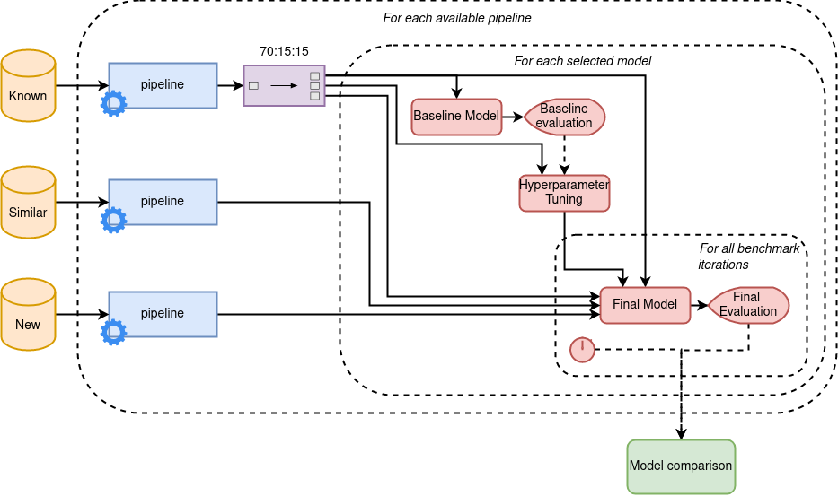

## DATA 245 Project

[Presentation](https://www.youtube.com/watch?v=8fjJgPkYYII)

This project builds and benchmarks fast, ML-based network threat detection on
the [TRAbID](https://secplab.ppgia.pucpr.br/?q=trabid) dataset, comparing Naive
Bayes, Logistic Regression, SVM, Random Forest, and XGBoost across multiple
preprocessing pipelines (scaling, correlation-based feature selection, and
PCA). After rebalancing massive, heavily imbalanced data and standardizing
evaluation across “Known,” “Similar,” and “New” attacks, we measure both
detection quality (F1, precision/recall) and end-to-end detection time.
Gaussian Naive Bayes with PCA (95% variance) achieved the best F1 on unseen
“New” attacks (~0.50), while Logistic Regression was the fastest (~24–36 ms).
Tree and SVM models often overfit, performing near-perfectly on “Known/Similar”
but collapsing on “New.” Results highlight the practicality of simple,
generative or linear models for fast, robust detection, with deployment paths
including a local firewall-style app using the best pipeline or publishing
model artifacts for research reuse.

Files:

- `./data/download_data.sh` and `./data/make_data.sh` - Download [dataset](https://secplab.ppgia.pucpr.br/?q=trabid) and convert to small csv
- `./data/*.csv` - The actual datasets used in training and evaluation
- `./exploring.ipynb` - Perform EDA on dataset
- `./model_*.ipynb` - Testing notebook for the given model (also save ROC curves to `./report/figures/`)
- `./benchmark.ipynb` - perform benchmark on all models and save results to `./benchmark_results.csv`
- `./benchmarkUtils.py` - common class for performing benchmarks in all notebooks
- `./results_analysis.ipynb` - Display results from `./benchmark_results.csv` in a neatly readable format
- `./results_analysis_to_latex.py` - Python script to generate tables in `./report/partial-tables/`
- `./requirements.txt` - Minimal set of requirements to set up environment
- `./report/` - Latex source code for report
- `./presentation/` - Mid and final project presentation
- `./report.pdf` - Report output as of `report` submodule commit hash 4fa5f16

---

Team members:

- Shrey Agarwal
- Ashwini Hiremath
- Ibrahim Khalid
- Harsh Shinde
- Justing Wang
